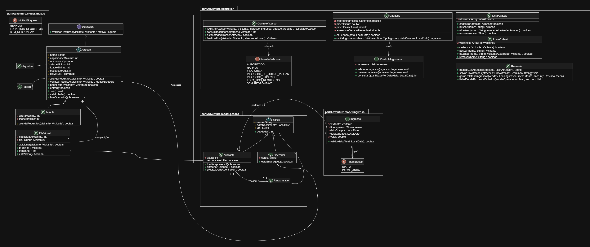

## Integrantes do grupo park adventure
* Caue Marques e Silva - caue.marques@ufrpe.br
* Edivan José da Silva Júnior - edivan.jose@ufrpe.br
* Humberto Severino do Nascimento Neto - humberto.neto@ufrpe.br
* João Victor Maciel Gomes da Silva - joaovictormaciell43@gmail.com
* Victor Mendes Ferreira de Lima - victormendes6767@gmail.com

# Sistema parkAdventure

## Descrição

Sistema para gestão de um parque temático/aquático, controlando atrações, visitantes, emissão de ingressos e o acesso às atrações por meio de fila virtual. O sistema deve respeitar restrições de altura e idade mínima por atração, além de controlar a capacidade simultânea de cada uma.

Como diferencial, o preço dos ingressos é ajustado dinamicamente em datas de feriado nacional, consultadas em tempo real via api pública, apoiando também o planejamento de escala de operadores em dias de maior movimento.

## Requisitos Funcionais

### 1. Cadastro de Atrações
- REQ01: Cadastrar atrações (nome, capacidade simultânea máxima, altura mínima em cm, idade mínima)
- REQ02: Implementar herança para tipos de atração: Radical, Aquática e Infantil
- REQ03: Vincular operadores responsáveis a cada atração

### 2. Visitantes e Ingressos
- REQ04: Cadastrar visitantes (nome, data de nascimento, altura em cm)
- REQ05: Emitir ingresso para um visitante, com tipo (Diária ou Passe Anual) e data de validade
- REQ06: Consultar quantidade de ingressos emitidos para uma determinada data

### 3. Precificação Dinâmica (api Pública)
- REQ07: Consultar a lista de feriados nacionais do ano vigente usando a api pública **BrasilAPI (Feriados Nacionais)**
- REQ08: Aplicar automaticamente um acréscimo percentual configurável no preço do ingresso Diária quando a data de emissão coincidir com um feriado nacional
- REQ09: Exibir no cadastro de emissão de ingresso um aviso visual quando a data escolhida for feriado

### 4. Controle de Acesso às Atrações
- REQ10: Registrar acesso de um visitante a uma atração (composição: fila virtual), vinculando ingresso e atração
- REQ11: Consultar ocupação atual (em tempo real) de uma atração, comparando com sua capacidade máxima
- REQ12: Liberar vaga na atração quando o visitante finaliza o uso

### 5. Relatórios e Escala
- REQ13: Relatório de atrações mais acessadas por período, exportável em CSV
- REQ14: Relatório de receita de ingressos por mês, destacando os dias de feriado
- REQ15: Listar operadores escalados para os próximos feriados nacionais (via api)

### 6. Regras e Restrições
- REQ16: **Bloquear** o acesso de um visitante a uma atração Radical quando sua altura for inferior à altura mínima exigida
- REQ17: **Impedir** o acesso a uma atração quando sua idade, calculada pela data de nascimento, for inferior à idade mínima
- REQ18: **Não permitir** registro de acesso a uma atração que já esteja em sua capacidade máxima simultânea
- REQ19: **Bloquear emissão** de ingresso Diária além da capacidade total diária do parque (soma das capacidades das atrações)
- REQ20: **Validar** que o ingresso esteja dentro da validade antes de autorizar qualquer acesso a atração
- REQ21: **Garantir** que toda atração tenha ao menos um operador responsável vinculado antes de ser aberta ao público

## Possíveis APIs/Bibliotecas

JavaFX, BrasilAPI — Feriados Nacionais (https://brasilapi.com.br/docs#tag/Feriados-Nacionais, pública e sem chave), `java.net.http.HttpClient`, Jackson/Gson, Java Time api, JUnit.

**Requisito bônus (opcional, fora da contagem oficial):** gerar uma página HTML estática com o calendário de feriados do ano e os dias de maior movimento previsto, aberta automaticamente no navegador via `Desktop.getDesktop().browse()`.

## Diagrama de Classes (UML)

O diagrama acima representa a estrutura das classes do projeto, desenvolvido em **Java** com Programação Orientada a Objetos.

### Hierarquia de atrações

- **`Atracao`** (classe abstrata): define os atributos e comportamentos comuns a todas as atrações do parque.
- **`Aquatico`**: classe filha de `Atracao`, representa as atrações aquáticas.
- **`Radical`**: classe filha de `Atracao`, representa as atrações radicais.
- **`Infantil`**: classe filha de `Atracao`, representa as atrações voltadas ao público infantil.

### Demais classes

- **`Operador`**: representa o funcionário responsável por operar as atrações.
- **`Visitante`**: representa os visitantes do parque.
- **`Fila`**: gerencia a fila de visitantes de cada atração.
- **`Relatorio`**: responsável por gerar os relatórios com as informações do parque.

### Conceitos de POO aplicados

- **Abstração:** `Atracao` define o modelo geral sem ser instanciada diretamente.
- **Herança:** `Aquatico`, `Radical` e `Infantil` herdam de `Atracao`.
- **Polimorfismo:** cada tipo de atração pode implementar seu próprio comportamento.

## Contas, senhas e escala de operadores

### Contas
- **Visitante** cria a própria conta (nome, CPF, usuário e senha). **Operadores só são cadastrados pelo administrador** (menu do administrador > "Operadores das Atrações").
- Usuário: mínimo de 3 caracteres, sem espaços, único. **Senha: mínimo de 6 caracteres.**

### Como a senha é gravada
A senha **nunca** é guardada em texto puro. Ao definir a senha, o sistema (classe `Senha`):
1. gera um *salt* aleatório de 16 bytes (diferente para cada senha);
2. calcula o hash com **PBKDF2-HMAC-SHA256**, 65.000 iterações, chave de 256 bits;
3. grava em `dados/dados.txt` apenas `salt$hash` (os dois em Base64).

No login, o hash é recalculado com o salt gravado e comparado em tempo constante com o guardado. Como o hash não pode ser
revertido, nem o administrador consegue ver uma senha: só é possível definir uma nova. Duas pessoas com a mesma senha
têm hashes diferentes (por causa do salt). Observação: a conta do administrador (`leandro`) é fixa no código.

### Operadores e escala
- Cada atração tem **vários operadores** (mínimo de 3). Ao iniciar, o sistema cria os que faltarem ("Operador 2 <atração>", ...)
  com a senha inicial `operador123`, que o administrador deve trocar.
- Há dois turnos de 4 horas por dia: **manhã (10:30-14:30)** e **tarde (14:30-18:30)**, cobrindo o atendimento das 11:00 às 18:00.
- Regras de carga horária: no máximo **1 turno por dia** por operador e **6 dias por semana** (folga semanal).
  Com 14 turnos por semana por atração, 3 operadores são o mínimo para cobrir todos os dias.
- O sistema monta a escala dos **próximos 30 dias** sozinho, revezando os operadores de cada atração por igual
  (`GeradorEscala`). Turnos escalados à mão são mantidos. Todo dia, cada atração tem operador nos dois turnos.
- O operador só entra na tela de **controle da atração** durante o próprio turno (hoje, entre o início e o fim do turno em que está escalado).
  Se o turno acabar com a tela aberta, os botões são travados na hora; quando o turno dele começa, são liberados de novo.
